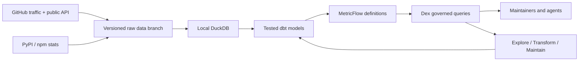

# GitHub repo analytics for open-source maintainers

**Keep your GitHub traffic beyond 14 days, see real star history, track release and PyPI/npm downloads, and measure community activity, all in a repository you own.** Metrics are defined once (dbt + MetricFlow), tested, and queryable by you or your coding agent through [Dex](https://github.com/exmergo/dex). Free on GitHub Actions; no paid warehouse, SaaS, or LLM API.

GitHub's Insights → Traffic page forgets everything after 14 days, shows only the top 10 referrers, and has no history for stars, downloads, or contributors. This template answers the questions maintainers actually ask:

| Question | Recipe |
|---|---|
| Are views and clones growing week over week? | `growth`, `traffic-trend` |
| When did my stars arrive, and what caused the spike? | `star-history`, `event-impact` |
| Where does traffic come from, and how is that changing? | `referrers`, `referrer-trend`, `referrer-change` |
| What do visitors read? | `paths`, `path-change` |
| How many PyPI / npm / release downloads did we get? | `package-downloads`, `release-downloads` |
| Is the community healthy? Issues opened vs closed, PRs merged, first-time contributors, time to merge | `community` |
| How do my projects compare? | `compare` |
| What happened this week? | `weekly-report` |
| Are the numbers fresh and complete enough to trust? | `status` |

## Try it in two minutes

Prerequisites: Git, [uv 0.13.1+](https://docs.astral.sh/uv/getting-started/installation/), macOS or Linux (Windows via WSL).

```bash
git clone https://github.com/exmergo/github-repo-analytics.git
cd github-repo-analytics
bash scripts/bootstrap.sh
uv run --frozen oss-analytics sync
uv run --frozen oss-analytics build
uv run --frozen oss-analytics baseline
uv run --frozen oss-analytics check
uv run --frozen oss-analytics question weekly-report --repository exmergo/dex
```

The example imports [Dex](https://github.com/exmergo/dex)'s public traffic history and collects its public forks, issues, releases, and PyPI downloads live. GitHub only serves star dates to authenticated requests, so for star history run `export GITHUB_TOKEN=$(gh auth token)` (any token, no scopes needed) before `sync`; without one, `star-history` reports itself unavailable. Real output from `question star-history --days 28 --grain week` on 2026-10-19:

```text
week        stars_gained  forks_created  stars_from_history
2026-09-21             0              0                  25
2026-09-28             0              0                  25
2026-10-05            36              1                  61
2026-10-12            27             12                  88
```

Every answer is a JSON envelope with the exact period (end exclusive), metric names, coverage, freshness, source revision, and code digest. An answer the data cannot support says so instead of guessing: a window past the last collected day, a missing snapshot, or a project without packages is reported as unavailable, never as zero.

## Track your own projects

1. [Create a repository from this template](https://github.com/exmergo/github-repo-analytics/generate). It opens a setup checklist issue.
2. Edit `sources.yml`:

   ```yaml
   repositories:
     - repository: your-org/your-project
       mode: collect
       packages:                 # optional; omit if you publish none
         pypi: [your-project]
   ```

3. Add a `GHRS_TOKEN` secret (fine-grained, **Administration: read** on tracked repos, **Contents: read/write** on this repo), allow Actions to write, and set the `ANALYTICS_ENABLED` variable to `true`. Details: [setup guide](docs/setup.md).

A daily workflow then collects traffic, referrers, paths, stars, forks, issues, releases, and downloads into a versioned `github-repo-stats` branch, rebuilds the models, checks them, and publishes only a validated revision. One analytics repository can track many projects.

**Collection publishes aggregates publicly.** Traffic counts, referrers, and popular paths normally need push access to see. No logins, names, emails, or issue text are ever stored. See [SECURITY.md](SECURITY.md).

## Ask with an agent

Point any coding agent at [AGENTS.md](AGENTS.md). It checks readiness, prefers the 20 executable recipes, and otherwise discovers the 39 governed metrics through Dex, so it never guesses a metric name or writes ad hoc SQL:

```bash
uv run --frozen oss-analytics status --json
uv run --frozen oss-analytics questions
uv run --frozen dex explore semantic list --local
uv run --frozen dex explore semantic query views,views_wow_growth,stars_gained \
  --group-by repository__name,metric_time --grain week --local
```

## How it works



Everything that defines a number lives in Git: `sources.yml`, the SQL models, and `models/semantic.yml`. The DuckDB file is rebuilt from pinned raw commits. Every model and metric change in this repository went through Dex: **explore** the warehouse before writing SQL, **transform** with a reviewable plan, a dev build, and row-level verification, and **maintain** by checking schema, volume, grain, and metric definitions against the committed baseline. The [Dex audit trail](.dex/review/README.md) holds the actual command output, including what Dex caught and the proposals that were rejected.

## Know what the numbers mean

- **Clones are not installs, and views include bots.** Daily unique counts are exposed as visitor-days and cloner-days, because one person counts again on each day and repository.
- **Star history dates current stargazers.** People who later unstarred are invisible, so past totals are lower bounds. `stars_observed` is the true current total.
- **Downloads are not users.** They exist only for uploaded release assets and configured packages, and include CI.
- **Referrers are a rolling top 10.** Snapshots are never summed, and a source missing from the top 10 is unreported, not zero.
- **First-time contributor PRs** are accurate from the start of daily collection; backfilled history undercounts.

Read the [metric contract](docs/metrics.md), [question cookbook](docs/questions.md), [architecture](docs/architecture.md), [Dex lifecycle](docs/lifecycle.md), and [operations guide](docs/operations.md).

## Contribute

```bash
bash scripts/bootstrap.sh
uv run --frozen pytest -q
uv run --frozen ruff check . && uv run --frozen ruff format --check .
```

Tests use two synthetic repositories, run real MetricFlow queries through Dex, and need no network or credentials. `pytest tests/test_live.py --live` opts into the public example. See [CONTRIBUTING.md](CONTRIBUTING.md) and the [code of conduct](CODE_OF_CONDUCT.md).

Apache-2.0. See [LICENSE](LICENSE) and [NOTICE](NOTICE).
