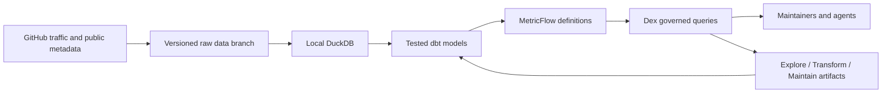

# How to track your open-source analytics

**Give your maintainers and their agents one place to answer questions about your project's growth.** Keep GitHub history, define metrics once, and query them locally with [Dex](https://github.com/exmergo/dex), DuckDB, dbt Core, and MetricFlow.

- Are views and clones growing over the last four weeks?
- Where is attention coming from, and how did those sources change?
- What content do visitors look at?
- Are stars and forks growing?
- What changed around a release, launch, or blog post?
- Are the data fresh and complete enough to answer?

No paid warehouse, dbt Cloud account, analytics subscription, or LLM API is required. All analytics software is open source. Standard GitHub Actions runners are free for public repositories; GitHub itself is the hosted source and scheduler. Agents are optional and use whichever model/runtime you choose.

## Ask your first question

Prerequisites: Git, [uv 0.13.1 or later](https://docs.astral.sh/uv/getting-started/installation/), and macOS or Linux (Windows users can use WSL). The bootstrap selects Python 3.11; CI also tests 3.12. The first import needs internet but **no GitHub token**.

```bash
git clone https://github.com/exmergo/how-to-track-your-open-source-analytics.git
cd how-to-track-your-open-source-analytics
bash scripts/bootstrap.sh
uv run --frozen oss-analytics sync
uv run --frozen oss-analytics build
uv run --frozen oss-analytics baseline
uv run --frozen oss-analytics check
uv run --frozen oss-analytics question growth --repository exmergo/dex --days 7
```

The example fetches `exmergo/dex`'s public `github-repo-stats` branch at an immutable commit. It supplements that history with a public star/fork observation and release dates. Subsequent syncs retain your observations. The original GitHub traffic API requires privileged access, but reading the already published example does not.

The initial baseline accepts the built state. On subsequent updates, run `sync`, `build`, and `check` first; review any drift before accepting a replacement baseline.

`uv.lock` pins the direct and transitive dependencies across supported platforms and Python versions. Bootstrap runs `uv sync --locked`; execute commands with `uv run --frozen` to use that lock without resolving updates. See [dependency maintenance](docs/operations.md#dependencies).

## Give your agent the repo

Point any coding agent at [AGENTS.md](AGENTS.md). The agent checks coverage, discovers MetricFlow metrics through Dex, and returns numbers with dates, definitions, and provenance.

```bash
uv run --frozen oss-analytics status --json
uv run --frozen oss-analytics questions
uv run --frozen dex explore semantic list --local
uv run --frozen dex explore semantic query views,clones \
  --group-by repository__name,metric_time --grain week --local
```

There are 14 executable recipes. See the [question cookbook](docs/questions.md) for historical snapshots and release comparisons. The recipe commands handle coverage checks; direct Dex queries give agents the full governed metric surface.

## Track your projects

[Create a repository from this template](https://github.com/exmergo/how-to-track-your-open-source-analytics/generate), edit `sources.yml`, and follow [setup](docs/setup.md). One analytics repo can track several public projects. Import existing `github-repo-stats` history or enable daily collection for projects you maintain.

**Enabling collection publishes traffic aggregates, referrers, and popular paths in your public data branch.** These traffic statistics normally require repository permission to read. The template keeps aggregate counts, not visitor identities.



The definitions and source configuration in Git are authoritative. The DuckDB file and `.dex/` exploration cache are reproducible. CI only promotes a candidate after its model, metric, and maintenance checks pass.

## Know what the numbers mean

GitHub activity measures attention. Clones do not establish installations or active use. Daily unique counts are exposed as **visitor-days** and **cloner-days**, because the same person can appear on several days or repositories. Rolling referrer snapshots are never summed. A source missing from a top-10 snapshot is unreported, not zero. Historical star/fork series from the upstream action are labeled separately from observed totals.

Read the [metric contract](docs/metrics.md), [architecture](docs/architecture.md), [Dex lifecycle tutorial](docs/lifecycle.md), and [operations guide](docs/operations.md).

The [Dex audit trail](.dex/review/README.md) contains the actual exploration, applied model/semantic plans, verified builds, and maintenance reports. Review `.dex/snapshot.json` as the shared maintenance baseline; plans and other engineering artifacts are visible to Git.

## Contribute

```bash
bash scripts/bootstrap.sh
uv run --frozen pytest -q
uv run --frozen ruff check .
uv run --frozen ruff format --check .
```

Normal tests use two synthetic repositories and never need credentials or network access. `uv run --frozen pytest tests/test_live.py --live` opts into the public example smoke test. See [CONTRIBUTING.md](CONTRIBUTING.md).

Apache-2.0. See [LICENSE](LICENSE) and [NOTICE](NOTICE) for attribution.
