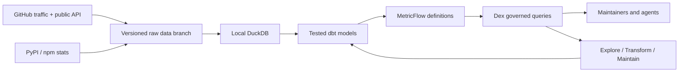

# GitHub repo analytics for open-source maintainers

**Own your project's growth data, in a repository you control.**


What you get:

- 📈 **Traffic history beyond 14 days.** Views, clones, referrers, and popular pages, kept forever.
- ⭐ **Real star history.** See when your stars arrived and what caused the spike.
- 📦 **Downloads.** GitHub release assets, PyPI, and npm.
- 🤝 **Community activity.** Issues opened vs closed, PRs merged, first-time contributors, time to merge.
- 🧮 **39 governed metrics you or your agent can query.** Defined once in MetricFlow, tested, and served through Dex, backed by a local DuckDB file and raw CSV history in a branch you own.

Metrics are defined once (dbt + MetricFlow), tested, and queryable by you or your coding agent through [Dex](https://github.com/exmergo/dex).

It runs free on GitHub Actions. No paid warehouse, no SaaS, no LLM API.

## Why

GitHub's **Insights → Traffic** page has real limits:

- It forgets everything after **14 days**.
- It shows only the **top 10** referrers.
- It has **no history** for stars, downloads, or contributors.

This template fixes that and answers the questions maintainers actually ask. Each question maps to a ready-made recipe (see the [question cookbook](docs/questions.md)):

| Question | Recipe |
|---|---|
| Are views and clones growing week over week? | `growth`, `traffic-trend` |
| When did my stars arrive, and what caused the spike? | `star-history`, `event-impact` |
| Where does traffic come from, and how is that changing? | `referrers`, `referrer-trend`, `referrer-change` |
| What do visitors read? | `paths`, `path-change` |
| How many PyPI / npm / release downloads did we get? | `package-downloads`, `release-downloads` |
| Is the community healthy? Issues opened vs closed, PRs merged, first-time contributors, time to merge | `community` |
| How do my projects compare? | `compare` |
| What happened this week? | `weekly-report` |
| Are the numbers fresh and complete enough to trust? | `status` |

Run any recipe with `uv run --frozen oss-analytics question <recipe>`.

## Real answers from a real project

This repository tracks [Dex](https://github.com/exmergo/dex), an open-source project for analytics engineering agents. Everything below is real output from the warehouse you build in [Try it in two minutes](#try-it-in-two-minutes), captured on 2026-10-22. Periods are end-exclusive.

### 120 days of traffic, where GitHub shows 14

`status` reports 120 observed traffic days for `exmergo/dex`, from 2026-06-23 to 2026-10-20, with no missing day: **11,462 views and 23,457 clones**. GitHub's own Traffic page would show the last 14 of them.

`question traffic-trend --repository exmergo/dex --days 91 --grain week`, the last eight complete weeks:

```text
week        views  clones
2026-08-24    621   1,022
2026-08-31  1,369   2,688
2026-09-07    324   1,132
2026-09-14    129     472
2026-09-21    119     513
2026-09-28    316   1,155
2026-10-05    976   1,113
2026-10-12  1,761   5,351
```

### The star spike, and what was behind it

`question star-history --repository exmergo/dex --days 91 --grain week`. Stars crept from 22 to 25 between mid-August and late September, then:

```text
week        stars_gained  forks_created  stars_from_history
2026-09-21             0              0                  25
2026-09-28             0              0                  25
2026-10-05            36              1                  61
2026-10-12            27             12                  88
```

**Was it a release?** `question event-impact` compares the 7 days before and after Dex v1.12.6 (2026-10-06). Views went from **343 to 1,523 (+344%)** and clones from 1,147 to 1,895 (+65%). The recipe does not credit the release: it names the **six other releases** inside those windows and labels the result "association only".

**Where did the visitors come from?** `question referrer-change` compares GitHub's rolling 14-day top 10 on two exact capture days:

```text
referrer        2026-09-22  2026-10-22
exmergo.com             15         588
github.com              83          77
linkedin.com             4          13
reddit.com              15           2
hn.algolia.com           1   (not in top 10)
```

In the 14 days before 2026-10-22, the project's own website sent 588 views, up from 15. A referrer that drops out of the top 10 is reported as unreported, never as zero.

### Community and downloads

`question community --repository exmergo/dex --days 28` (2026-09-24 to 2026-10-22):

```text
issues opened  issues closed  PRs opened  PRs merged  median time to merge
          175             95         118         106          11.6 hours
```

`question package-downloads --repository exmergo/dex --days 28`, PyPI downloads of `exmergo-dex-core` per complete week: **894, then 1,611, then 1,651**.

### And what it refuses to make up

`question weekly-report` returns traffic growth, stars, community, and downloads in one envelope. Its release-downloads section for Dex reads:

> This repository has no release assets captured; GitHub counts downloads only for uploaded assets, not source archives.

Every answer is a JSON envelope with the exact period, metric names, coverage, freshness, source revision, and code digest. When the data cannot support an answer, it says so, and missing data is **unavailable, never zero**.

## Try it in two minutes

**Prerequisites**

- Git
- [uv 0.13.1+](https://docs.astral.sh/uv/getting-started/installation/)
- macOS or Linux (Windows via WSL)

**1. Clone and bootstrap**

```bash
git clone https://github.com/exmergo/github-repo-analytics.git
cd github-repo-analytics
bash scripts/bootstrap.sh
```

**2. Collect, build, and check the data**

```bash
uv run --frozen oss-analytics sync       # import and collect raw data
uv run --frozen oss-analytics build      # build the tested models
uv run --frozen oss-analytics baseline   # record the accepted baseline
uv run --frozen oss-analytics check      # verify against the baseline
```

> [!TIP]
> **Want star history?** GitHub only serves star dates to authenticated requests. Run this before `sync` (any token works, no scopes needed):
>
> ```bash
> export GITHUB_TOKEN=$(gh auth token)
> ```
>
> Without a token, `star-history` reports itself unavailable.

**3. Ask a question**

```bash
uv run --frozen oss-analytics question weekly-report --repository exmergo/dex
```

You get the numbers in [Real answers](#real-answers-from-a-real-project), updated to the latest published day. The example imports Dex's public traffic history and collects its forks, issues, releases, and PyPI downloads live. The second source is this repository itself, so `--repository exmergo/github-repo-analytics` shows the template tracking its own launch.

**4. Query the governed metrics**

Recipes cover the common questions. For everything else, query the semantic layer: **39 metrics** defined once in [`models/semantic.yml`](models/semantic.yml), compiled by MetricFlow, and run through Dex. This is the path for agents. Metric names are discovered rather than guessed, every metric is tested, and MetricFlow handles the joins and time grains, so the answer is the same number every time.

Discover what exists. Each metric carries its meaning in its description (condensed from the JSON envelope):

```bash
uv run --frozen dex explore semantic list --local
```

```text
views               simple      Total GitHub page views. May include automated activity.
stars_gained        simple      Stars from current stargazers by the day they starred. ...
stars_from_history  cumulative  Running total of current stargazers at the end of each period ...
views_wow_growth    derived     Relative change in views versus the previous week; query at week grain ...
... 39 metrics
```

Read a dimension's values before filtering on it:

```bash
uv run --frozen dex explore semantic values repository__name --metric views --local
# exmergo/dex, exmergo/github-repo-analytics
```

Query several metrics at once, by month, for complete months:

```bash
uv run --frozen dex explore semantic query views,clones,stars_gained,prs_merged,pypi_downloads \
  --group-by metric_time --grain month \
  --where "{{ Dimension('repository__name') }} = 'exmergo/dex'" \
  --where "{{ TimeDimension('metric_time', 'day') }} >= '2026-07-01' and {{ TimeDimension('metric_time', 'day') }} < '2026-10-01'" \
  --order-by metric_time --local
```

```text
month    views  clones  stars_gained  prs_merged  pypi_downloads
2026-07  3,167   4,645            15          77           5,070
2026-08  3,274   5,013             9          83           4,857
2026-09  1,728   4,772             1          54           2,587
```

Derived metrics work the same way. Here, week-over-week growth:

```bash
uv run --frozen dex explore semantic query views,views_wow_growth,stars_gained \
  --group-by metric_time --grain week \
  --where "{{ Dimension('repository__name') }} = 'exmergo/dex'" \
  --where "{{ TimeDimension('metric_time', 'day') }} >= '2026-09-21' and {{ TimeDimension('metric_time', 'day') }} < '2026-10-19'" \
  --order-by metric_time --local
```

```text
week        views  views_wow_growth  stars_gained
2026-09-21    119             -7.8%             0
2026-09-28    316           +165.5%             0
2026-10-05    976           +208.9%            36
2026-10-12  1,761            +80.4%            27
```

Each answer is a JSON envelope (`data.columns`, `data.cells`, warnings, and whether the result was `truncated`). Dex returns at most 50 rows per query, so pick a coarser grain rather than reading a truncated result. Filters use MetricFlow's `Dimension` and `TimeDimension` syntax. [AGENTS.md](AGENTS.md) has the full rules for reading each metric.

**5. Or open the DuckDB file**

`build` writes everything to **`warehouse/analytics.duckdb`**:

| Schema | What is in it |
|---|---|
| `raw` | Each source as collected, for example `traffic`, `stargazer_days`, `fork_days`, `issues`, `discovery` (referrers and paths), `observations`, `releases`, `release_assets`, `package_downloads` |
| `main.stg_*` | Typed staging views over `raw` |
| `main.fct_*`, `main.dim_*` | The tested marts the metrics read: `fct_traffic` (one row per repository and day), `fct_star_history`, `fct_fork_history`, `fct_issues`, `fct_referrer`, `fct_path`, `fct_package_downloads`, `fct_release_downloads`, `fct_observations`, `dim_event`, `dim_repository` |

Open it with any DuckDB client. With the Python package that `bootstrap.sh` already installed:

```bash
uv run --frozen python -c "import duckdb; print(duckdb.connect('warehouse/analytics.duckdb', read_only=True).sql('''
  select strftime(date, '%Y-%m') as month, sum(views_total) as views, sum(clones_total) as clones
  from fct_traffic where repository = 'exmergo/dex' group by 1 order by 1'''))"
```

```text
┌─────────┬────────┬────────┐
│  month  │ views  │ clones │
│ varchar │ int128 │ int128 │
├─────────┼────────┼────────┤
│ 2026-06 │    228 │     97 │
│ 2026-07 │   3167 │   4645 │
│ 2026-08 │   3274 │   5013 │
│ 2026-09 │   1728 │   4772 │
│ 2026-10 │   3065 │   8930 │
└─────────┴────────┴────────┘
```

Or use the [DuckDB CLI](https://duckdb.org/docs/installation/) (`duckdb -readonly warehouse/analytics.duckdb`), or `uv run --frozen dex explore query "<SELECT ...>"`, which reads the same file through Dex's read-only, PII-aware guard.

Open it read-only: `build` replaces the file from the raw data each time. Ad hoc SQL is for exploring. For numbers you report, use the recipes or the governed metrics, which already handle the traps. For example, summing `views_unique` across days counts the same person again every day.

**No lock-in:** the raw history lives in this repository's `github-repo-stats` branch as plain files:
- per project, `ghrs-data/views_clones_aggregate.csv` and the daily top-10 referrer and path snapshots;
- `signals/*.csv` for stars, forks, and issues;
- `metadata/*.json` captures.

Any tool can read them, even if you stop using this template.

## Track your own projects

1. **[Create a repository from this template](https://github.com/exmergo/github-repo-analytics/generate).** It opens a setup checklist issue for you.

2. **List your projects in [`sources.yml`](sources.yml):**

   ```yaml
   repositories:
     - repository: your-org/your-project
       mode: collect
       packages:                 # optional; omit if you publish none
         pypi: [your-project]
   ```

   See [Track package downloads](docs/setup.md#track-package-downloads-optional) for npm and more options.

3. **Give the workflow access:**
   - Add a `GHRS_TOKEN` secret: a fine-grained token with **Administration: read** on tracked repos and **Contents: read/write** on this repo ([how to create it](docs/setup.md#create-the-token)).
   - Set the `ANALYTICS_ENABLED` repository variable to `true` ([details](docs/setup.md#enable-collection)).

The full walkthrough is in the [setup guide](docs/setup.md).

**What happens next:** a [daily workflow](.github/workflows/repo-stats.yml) collects traffic, referrers, paths, stars, forks, issues, releases, and downloads into a versioned `github-repo-stats` branch. It then rebuilds the models, checks them, and publishes only a validated revision. If a scheduled run fails, it opens an "Analytics collection is failing" issue, and raw data already collected is kept.

GitHub only keeps traffic for 14 days, so **traffic history starts the day you turn collection on** (star, fork, and issue history is backfilled). Set it up before your next launch, not after.

One analytics repository can track many projects.

> [!IMPORTANT]
> **Collection publishes aggregates publicly.** Traffic counts, referrers, and popular paths normally need push access to see. No logins, names, emails, or issue text are ever stored. See [SECURITY.md](SECURITY.md).

## Ask with an agent

Point any coding agent at [AGENTS.md](AGENTS.md) and ask in plain language. Asked "did the v1.12.6 release drive traffic?", an agent following it:

1. checks `status`, and sees the data is fresh with no missing days;
2. picks the `event-impact` recipe rather than writing SQL;
3. answers with the numbers above: views +344% in the 7 days after, clones +65%. It also says this is an association, and that six other releases fall inside the same windows.

When no recipe fits, it discovers the 39 governed metrics in [`models/semantic.yml`](models/semantic.yml) through Dex, so it never guesses a metric name.

```bash
uv run --frozen oss-analytics status --json      # is the data ready?
uv run --frozen oss-analytics questions          # list available recipes
uv run --frozen dex explore semantic list --local   # list governed metrics
uv run --frozen dex explore semantic query views,views_wow_growth,stars_gained \
  --group-by repository__name,metric_time --grain week --local
```

## How it works



**Everything that defines a number lives in Git:** [`sources.yml`](sources.yml), the [SQL models](models/), and [`models/semantic.yml`](models/semantic.yml). The DuckDB file is rebuilt from pinned raw commits.

**Every model and metric change went through Dex** ([lifecycle guide](docs/lifecycle.md)):

| Step | What it does |
|---|---|
| [**Explore**](.agents/skills/explore/SKILL.md) | Inspect the warehouse before writing any SQL. |
| [**Transform**](.agents/skills/transform/SKILL.md) | Make changes through a reviewable plan, a dev build, and row-level verification. |
| [**Maintain**](.agents/skills/maintain/SKILL.md) | Check schema, volume, grain, and metric definitions against the committed baseline. |

### What Dex does in this project

The [audit trail](.dex/review/README.md) holds the raw command output for each of these:

- **Every change is proven before it lands.** Models change through reviewable plans. Before anything was written, a refactor of `fct_legacy` was shown to return exactly the same rows: 33 before, 33 after ([step 09](.dex/review/09-marts-plan.json)).
- **The semantic layer only grows through checked plans.** One plan added 27 metric definitions, left 21 untouched, and was parsed by dbt before it was stored, so it could not land broken ([step 13](.dex/review/13-semantic-plan.json)).
- **Metric meanings cannot change silently.** The daily run compares every definition with the committed baseline, and a changed metric is held until someone reviews it ([step 24](.dex/review/24-check-catches-definition-change.json)).
- **New data is checked before it is published.** When a second project joined, the run held publication, Dex showed exactly what changed, and the reviewed result went out the same day ([steps 35–37](.dex/review/README.md#follow-up-adding-a-second-repository-2026-10-22)).
- **Upgrades are maintained like any other change.** Moving to Dex 1.15.2 meant checking against the previous baseline, tracing every finding to real new data, and only then accepting a new baseline ([steps 40–49](.dex/review/README.md#maintenance-dex-1152-and-a-day-of-new-data-2026-10-22)).

## Know what the numbers mean

- **Clones are not installs, and views include bots.** Daily unique counts are exposed as visitor-days and cloner-days, because one person counts again on each day and repository.
- **Star history dates current stargazers.** People who later unstarred are invisible, so past totals are lower bounds. `stars_observed` is the true current total.
- **Downloads are not users.** They exist only for uploaded release assets and configured packages, and include CI.
- **Release downloads are tested on synthetic data only.** Neither example project uploads release assets, so these metrics have not yet run against live data. [Open an issue](https://github.com/exmergo/github-repo-analytics/issues/new/choose) if your numbers look wrong.
- **Referrers are a rolling top 10.** Snapshots are never summed. A source missing from the top 10 is unreported, not zero.
- **First-time contributor PRs** are accurate from the start of daily collection. Backfilled history undercounts.

### Further reading

- [Metric contract](docs/metrics.md): every metric and its exact meaning
- [Question cookbook](docs/questions.md): all recipes with examples
- [Setup guide](docs/setup.md): tokens, collection, packages, campaign context
- [Architecture](docs/architecture.md): how the pieces fit together and where data comes from
- [Dex lifecycle](docs/lifecycle.md): explore, transform, maintain in practice
- [Operations guide](docs/operations.md): daily runs, freshness, and recovery from failures

## Contribute

```bash
bash scripts/bootstrap.sh                                               # set up the environment
uv run --frozen pytest -q                                               # run the test suite
uv run --frozen ruff check . && uv run --frozen ruff format --check .   # lint and format
```

The [tests](tests/) use two synthetic repositories and run real MetricFlow queries through Dex. They need no network or credentials. To opt into the public example, run `pytest tests/test_live.py --live`.

Please read [CONTRIBUTING.md](CONTRIBUTING.md) and the [code of conduct](CODE_OF_CONDUCT.md).

## License

Apache-2.0. See [LICENSE](LICENSE) and [NOTICE](NOTICE).
