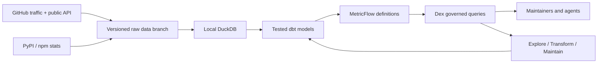

# GitHub repo analytics for open-source maintainers

**Own your project's growth data, in a repository you control.**

What you get:

- 📈 **Traffic history beyond 14 days.** Views, clones, referrers, and popular pages, kept forever.
- ⭐ **Real star history.** See when your stars arrived and what caused the spike.
- 📦 **Downloads.** GitHub release assets, PyPI, and npm.
- 🤝 **Community activity.** Issues opened vs closed, PRs merged, first-time contributors, time to merge.

Metrics are defined once (dbt + MetricFlow), tested, and queryable by you or your coding agent through [Dex](https://github.com/exmergo/dex).

It runs free on GitHub Actions. No paid warehouse, no SaaS, no LLM API.

## Why

GitHub's **Insights → Traffic** page has real limits:

- It forgets everything after **14 days**.
- It shows only the **top 10** referrers.
- It has **no history** for stars, downloads, or contributors.

This template fixes that and answers the questions maintainers actually ask. Each question maps to a ready-made recipe (see the [question cookbook](docs/questions.md)):

| Question | Recipe |
|---|---|
| Are views and clones growing week over week? | `growth`, `traffic-trend` |
| When did my stars arrive, and what caused the spike? | `star-history`, `event-impact` |
| Where does traffic come from, and how is that changing? | `referrers`, `referrer-trend`, `referrer-change` |
| What do visitors read? | `paths`, `path-change` |
| How many PyPI / npm / release downloads did we get? | `package-downloads`, `release-downloads` |
| Is the community healthy? Issues opened vs closed, PRs merged, first-time contributors, time to merge | `community` |
| How do my projects compare? | `compare` |
| What happened this week? | `weekly-report` |
| Are the numbers fresh and complete enough to trust? | `status` |

Run any recipe with `uv run --frozen oss-analytics question <recipe>`.

## Try it in two minutes

**Prerequisites**

- Git
- [uv 0.13.1+](https://docs.astral.sh/uv/getting-started/installation/)
- macOS or Linux (Windows via WSL)

**1. Clone and bootstrap**

```bash
git clone https://github.com/exmergo/github-repo-analytics.git
cd github-repo-analytics
bash scripts/bootstrap.sh
```

**2. Collect, build, and check the data**

```bash
uv run --frozen oss-analytics sync       # import and collect raw data
uv run --frozen oss-analytics build      # build the tested models
uv run --frozen oss-analytics baseline   # record the accepted baseline
uv run --frozen oss-analytics check      # verify against the baseline
```

**3. Ask a question**

```bash
uv run --frozen oss-analytics question weekly-report --repository exmergo/dex
```

The example imports [Dex](https://github.com/exmergo/dex)'s public traffic history. It also collects its public forks, issues, releases, and PyPI downloads live.

> [!TIP]
> **Want star history?** GitHub only serves star dates to authenticated requests. Run this before `sync` (any token works, no scopes needed):
>
> ```bash
> export GITHUB_TOKEN=$(gh auth token)
> ```
>
> Without a token, `star-history` reports itself unavailable.

Real output from `question star-history --days 28 --grain week` on 2026-10-19:

```text
week        stars_gained  forks_created  stars_from_history
2026-09-21             0              0                  25
2026-09-28             0              0                  25
2026-10-05            36              1                  61
2026-10-12            27             12                  88
```

**Every answer is honest about its evidence:**

- It comes as a JSON envelope with the exact period (end exclusive), metric names, coverage, freshness, source revision, and code digest.
- When the data cannot support an answer, it says so instead of guessing. A window past the last collected day, a missing snapshot, or a project without packages is reported as **unavailable, never as zero**.

## Track your own projects

1. **[Create a repository from this template](https://github.com/exmergo/github-repo-analytics/generate).** It opens a setup checklist issue for you.

2. **List your projects in [`sources.yml`](sources.yml):**

   ```yaml
   repositories:
     - repository: your-org/your-project
       mode: collect
       packages:                 # optional; omit if you publish none
         pypi: [your-project]
   ```

   See [Track package downloads](docs/setup.md#track-package-downloads-optional) for npm and more options.

3. **Give the workflow access:**
   - Add a `GHRS_TOKEN` secret: a fine-grained token with **Administration: read** on tracked repos and **Contents: read/write** on this repo ([how to create it](docs/setup.md#create-the-token)).
   - Allow Actions to write.
   - Set the `ANALYTICS_ENABLED` repository variable to `true` ([details](docs/setup.md#enable-collection)).

The full walkthrough is in the [setup guide](docs/setup.md).

**What happens next:** a [daily workflow](.github/workflows/repo-stats.yml) collects traffic, referrers, paths, stars, forks, issues, releases, and downloads into a versioned `github-repo-stats` branch. It then rebuilds the models, checks them, and publishes only a validated revision.

One analytics repository can track many projects.

> [!IMPORTANT]
> **Collection publishes aggregates publicly.** Traffic counts, referrers, and popular paths normally need push access to see. No logins, names, emails, or issue text are ever stored. See [SECURITY.md](SECURITY.md).

## Ask with an agent

Point any coding agent at [AGENTS.md](AGENTS.md). The agent will:

- check data readiness first,
- prefer one of the 20 executable [recipes](docs/questions.md),
- otherwise discover the 39 governed metrics in [`models/semantic.yml`](models/semantic.yml) through Dex.

So it never guesses a metric name or writes ad hoc SQL.

```bash
uv run --frozen oss-analytics status --json      # is the data ready?
uv run --frozen oss-analytics questions          # list available recipes
uv run --frozen dex explore semantic list --local   # list governed metrics
uv run --frozen dex explore semantic query views,views_wow_growth,stars_gained \
  --group-by repository__name,metric_time --grain week --local
```

## How it works



**Everything that defines a number lives in Git:** [`sources.yml`](sources.yml), the [SQL models](models/), and [`models/semantic.yml`](models/semantic.yml). The DuckDB file is rebuilt from pinned raw commits.

**Every model and metric change went through Dex** ([lifecycle guide](docs/lifecycle.md)):

| Step | What it does |
|---|---|
| [**Explore**](.agents/skills/explore/SKILL.md) | Inspect the warehouse before writing any SQL. |
| [**Transform**](.agents/skills/transform/SKILL.md) | Make changes through a reviewable plan, a dev build, and row-level verification. |
| [**Maintain**](.agents/skills/maintain/SKILL.md) | Check schema, volume, grain, and metric definitions against the committed baseline. |

The [Dex audit trail](.dex/review/README.md) holds the actual command output, including what Dex caught and the proposals that were rejected.

## Know what the numbers mean

- **Clones are not installs, and views include bots.** Daily unique counts are exposed as visitor-days and cloner-days, because one person counts again on each day and repository.
- **Star history dates current stargazers.** People who later unstarred are invisible, so past totals are lower bounds. `stars_observed` is the true current total.
- **Downloads are not users.** They exist only for uploaded release assets and configured packages, and include CI.
- **Referrers are a rolling top 10.** Snapshots are never summed. A source missing from the top 10 is unreported, not zero.
- **First-time contributor PRs** are accurate from the start of daily collection. Backfilled history undercounts.

### Further reading

- [Metric contract](docs/metrics.md): every metric and its exact meaning
- [Question cookbook](docs/questions.md): all recipes with examples
- [Setup guide](docs/setup.md): tokens, collection, packages, campaign context
- [Architecture](docs/architecture.md): how the pieces fit together and where data comes from
- [Dex lifecycle](docs/lifecycle.md): explore, transform, maintain in practice
- [Operations guide](docs/operations.md): daily runs, freshness, and recovery from failures

## Contribute

```bash
bash scripts/bootstrap.sh                                               # set up the environment
uv run --frozen pytest -q                                               # run the test suite
uv run --frozen ruff check . && uv run --frozen ruff format --check .   # lint and format
```

The [tests](tests/) use two synthetic repositories and run real MetricFlow queries through Dex. They need no network or credentials. To opt into the public example, run `pytest tests/test_live.py --live`.

Please read [CONTRIBUTING.md](CONTRIBUTING.md) and the [code of conduct](CODE_OF_CONDUCT.md).

## License

Apache-2.0. See [LICENSE](LICENSE) and [NOTICE](NOTICE).
