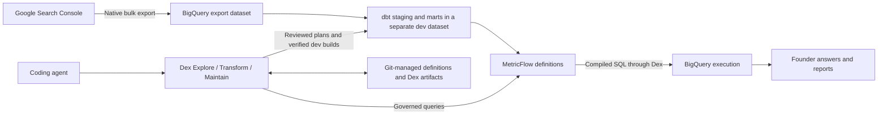

# Google Search Console Analytics — grand design

Status: proposed design, 2026-10-24. Companion: [execution plan](google-search-console-analytics-execution-plan.md).

This describes a new repository. It does not change the existing GitHub analytics project. The existing BigQuery ingestion is the starting point for implementation; its actual schema, history, permissions, and coverage still need to be inspected with Dex. Proposed model, metric, and recipe names below are design contracts, not claims that they already exist.

## 1. Name and promise

Use **`google-search-console-analytics`** as the repository name and **Google Search Console Analytics for Founders** as the README title. The name tells people which data it works with and what they get. Use `gsc-analytics` for the proposed command-line wrapper and `google_search_console_analytics` for the dbt project. Confirm repository-name availability when creating it.

The founder's request:

> I run my startup's marketing myself. I want to keep my Google search history, see which pages and searches are bringing traffic, and know which existing pages deserve attention this week. I want to ask my coding agent, without exporting spreadsheets or writing SQL every time.

Proposed README lead:

> **Own your Google search history. Ask your agent which pages to work on next.**
>
> Connect Search Console's BigQuery export to a tested analytics project. Track search traffic, separate brand searches from discovery, and investigate pages gaining or losing clicks—with dbt, MetricFlow, and Dex.

The ingestion tutorial is part of the product. Google already supplies the pipeline; this repository supplies definitions, useful questions, evidence, and an agent that knows how to work with them.

**Commercial objective:** help a founder get one useful answer, return for a weekly review, and extend the project with Dex. The Enterprise opportunity appears when the team wants agents to handle more analytics work across its BigQuery/dbt estate.

## 2. Product boundaries

### Launch audience

- Technical founders and small startup teams running their own content and search marketing.
- One Search Console property initially, with an existing export or willingness to enable one.
- A coding agent with a local shell, or a developer comfortable running the documented commands.
- Existing BigQuery exports provide the fastest path to meaningful historical comparisons.

### Included in v1

- Google's native daily bulk export into BigQuery, including a setup tutorial.
- A BigQuery-native dbt project with a tested MetricFlow layer.
- Dex as the engineering and governed-query path, including `/dex:explore`, `/dex:transform`, and `/dex:maintain` examples.
- A small executable question cookbook, availability checks, and structured answer evidence.
- Configurable brand terms and mutually exclusive page groups.
- A weekly report, export-health checks, and an opt-in scheduled workflow.
- Reviewable Dex artifacts and a worked example of extending and maintaining the project.
- A public example generated from approved real data; synthetic fixtures for deterministic tests.

### Deferred

- Search Console API historical backfill. Do not blend API rows into the bulk-export tables: the populations and coverage differ. A later adapter must preserve provenance and avoid overlap.
- GA4, Stripe, CRM, paid advertising, backlinks, rank scraping, and competitor data.
- A hosted dashboard, chat service, or custom ingestion service.
- Multiple properties in different BigQuery regions. Keep property identity in all grains so same-region expansion is possible later.
- Automated content rewriting or publishing.

Search Console alone cannot establish signups, customers, revenue, conversion rates, or whether a content edit caused a change. These answers explicitly name the missing source or experiment.

## 3. Founder questions are the public interface

Ship a small set of questions whose output supports a concrete next action. Defaults use Google web search and one explicitly selected property. Other search types remain separate until their metric applicability is tested.

| Priority / recipe | What the founder asks | Useful answer and next action | Availability contract |
|---|---|---|---|
| P0 `weekly-review` | “What changed in Google search this week, and which three pages should I inspect first?” | Latest complete week versus the preceding week; site change, page movers, query evidence, and links to deeper recipes. Distinguish findings from suggestions. | Two complete Monday–Sunday weeks in the source date timezone; each component reports its own availability. |
| P0 `search-growth` | “Did Google send more clicks over the last 28 complete days than the 28 before?” | Site clicks, impressions, CTR, and weighted average position; absolute and relative changes. | Two complete, adjacent, non-overlapping 28-day periods. |
| P0 `nonbrand-growth` | “Are more people finding us without searching for our company or product name?” | Branded, non-branded, and unclassified/anonymized traffic, with known-query coverage. Decide whether discovery is growing. | Same 28-day comparison plus reviewed brand rules. Unknown query text stays unknown. |
| P0 `page-movers` | “Which pages lost the most Google clicks, and which gained the most?” | Rank by absolute click change across the full eligible URL population; show counts, impressions, CTR, and position for both periods. | Both URL-export periods complete; include pages present in only one period under the explicit zero-observation rule below. |
| P0 `query-movers` | “Which actual searches explain the change in traffic to this page?” | Query-level gains and losses for a selected URL, plus the anonymous contribution that cannot be named. | Complete URL/query coverage for both periods; a missing query string is not a recovered keyword. |
| P0 `page-opportunities` | “Which existing pages already get search impressions but few clicks, so I have evidence to investigate before writing another post?” | A shortlist of page/query pairs, impressions, clicks, CTR, position, and device/country context. Link to the page for manual title, intent, and result inspection. | One complete 28-day window; explicit configurable minimum impressions. Descriptive candidates, not promised extra clicks. |
| P0 `content-groups` | “Are our blog, docs, comparison pages, or product pages bringing more search clicks?” | Compare configured page groups on URL-level metrics; show unmatched pages. Decide where to investigate content investment. | Reviewed ordered path rules and complete URL periods. Clicks are not customers or ROI. |
| P0 `export-health` | “Did traffic fall, or has the export stopped arriving?” | Per-source last successful date, holes, build state, and revision changes. Withhold unsupported comparisons. | Works even when marketing recipes cannot run. |
| P1 `page-change` | “I updated this page on a particular date. What changed in its search performance afterward?” | Equal complete before/after windows with query mix, device/country context, and other recorded changes. | User-supplied event date; no overlap; complete follow-up; association only. |
| P1 `new-content` | “Which posts we published last month have started getting search clicks?” | Pages from a supplied publication-date inventory, performance at matched ages where available, and no-observation status. | Requires actual publication dates; first impression is never substituted for publication. |

### Keep the questions honest

- The weekly summary is composed from governed recipe results, not an LLM inventing analyses from a warehouse dump.
- Offer observed search queries as evidence of demand. Do not call them total keyword search volume.
- A low CTR candidate may reflect rank, intent, SERP layout, or audience mix. The recommendation is to inspect it, not automatically rewrite it.
- Several URLs observed for one query do not, by themselves, prove cannibalization.
- A move in weighted average position may reflect a changed query mix. Selected-page investigations expose that mix before claiming a ranking improvement.
- Thresholds and brand/path rules are visible configuration with versioned definitions. They are not universal SEO benchmarks.

## 4. The user journey

### A. Already exporting to BigQuery

1. Create a **private** repository from the template.
2. Bootstrap the pinned dependencies and install the Dex skills/plugin for the chosen agent.
3. Select project, existing export dataset, location, property, and a separate writable dev dataset.
4. Authenticate locally through Application Default Credentials; never paste credentials into a prompt.
5. Let Dex inspect the export and explain its actual coverage and proposed spend.
6. Build and verify the supplied models through Dex; accept an initial baseline only after the checks pass.
7. Ask the first available founder question. Add brand terms and page groups when needed.

Do not restart, rename, or migrate a working export just to fit the template.

### B. Starting without an export

Give the README a short “Enable the export” section, with a linked walkthrough:

1. Verify Search Console ownership and Google Cloud billing/API prerequisites.
2. Grant Google's documented export principal the required access.
3. In Search Console settings, enter the project, choose a `searchconsole`-prefixed dataset name and location, then enable bulk export.
4. Check export status and the created tables; verify retention settings support the intended history.

Describe this as **about five minutes to configure once prerequisites are ready**. The first export can take up to 48 hours, and native bulk export does not backfill earlier history. BigQuery storage and query costs apply. The setup tutorial must make these distinctions visible before the user starts. [Google setup instructions](https://support.google.com/webmasters/answer/12917675?hl=en).

A new property sees an honest “collecting history” state with the earliest date each recipe can become available. It can inspect the sample report while waiting. Never silently shorten the promised comparison.

### C. Weekly use

Open the repo in the agent, ask for the weekly review, inspect a page, and save the chosen actions. The report cites exact periods and its evidence. An opt-in GitHub Actions workflow can refresh/check the project and produce a private report artifact; scheduled execution does not require an LLM.

### D. Extension with Dex

After the first answer, demonstrate a request such as “Separate `/compare/` pages from product pages.” The agent inspects the current model, creates a Transform plan, shows changed rows and metric impact where supported, builds on dev, and compares with the accepted baseline. This is the bridge from a useful template to understanding Dex.

## 5. Architecture and ownership



This is a proposed architecture diagram. The implementation must also publish the actual warehouse diagram returned by `dex explore diagram`, unedited, with its coverage notes.

| Component | Responsibility |
|---|---|
| Search Console | Owns ingestion and revisions to its export tables. |
| BigQuery | Stores source history and derived analytics; executes scoped queries. |
| dbt | Declares source contracts and transforms exported records into tested grains. |
| MetricFlow | Defines measures, ratios, dimensions, and time semantics; compiles governed metric queries. |
| Dex | Explores, validates plans, applies project edits, builds on dev, queries metrics, and checks drift. |
| Thin `gsc-analytics` wrapper | Reports readiness, selects recipes/windows, invokes Dex, checks envelopes, and formats evidence. It does not implement another metric engine. |
| GitHub Actions | Optional scheduling and test execution under a user-approved identity and budget. |

Use local MetricFlow through Dex against BigQuery. Here, `--local` describes the semantic compilation/execution route; **the data stays in BigQuery and queries can incur charges**. No dbt Cloud subscription is required for this design. Pin and prove a compatible Dex/dbt/MetricFlow/BigQuery-adapter combination before expanding the project.

### Source contract to verify with Explore

Google supplies `searchdata_site_impression`, `searchdata_url_impression`, and `ExportLog`. Site and URL data use different aggregation scopes; repeated raw keys are legitimate contributions to aggregate. Export dates use Pacific Time. ExportLog records successful table/date publications and revision epochs. Source revisions can replace an older day's data. [Google table reference](https://support.google.com/webmasters/answer/12917991?hl=en).

These are expected source characteristics. Explore must establish the actual columns, values, grains, scope, and coverage in the user's export before authoring SQL.

### Proposed model families

| Layer | Proposed models | Purpose / intended grain |
|---|---|---|
| Staging | `stg_gsc_site`, `stg_gsc_url`, `stg_gsc_export_log` | Explicit types and field selection, preserving all metric contributions. No arbitrary deduplication. |
| Intermediate | `int_gsc_export_coverage`, `int_gsc_brand_rules`, `int_gsc_page_groups` | Per-source coverage/revisions and deterministic classification. |
| Marts | `fct_search_site_daily` | Date × property × query identity/anonymity × country × device × search type. Site-wide questions. |
| Marts | `fct_search_url_daily` | Date × property × URL × query identity/anonymity × country × device × search type. Aggregate omitted appearance dimensions explicitly. Page questions. |
| Dimensions | `dim_property`, `dim_page`, `metricflow_time_spine` | Unique join keys, page-group rules, and a tested daily time spine. |
| Comparison marts if needed | `fct_page_comparison`, `fct_query_comparison` | One entity/slice per anchor date and supported window; current/prior measures for complete-population mover ranking. |
| Operations | `fct_export_coverage`, `fct_build_status` | Source completeness and which code/source revision has a validated build. |

Validate intended grains against real data and declare them through Transform. Site and URL facts remain independent: do not join them on date/property/query to obtain both sets of measures. That risks fanout and mixes populations. Shared dimensions must have verified unique keys.

Keep exact URLs as source identities. Derive a path for classification without collapsing distinct URLs by an unreviewed normalization rule. Page groups use first-match precedence with an `other` category; one page has one group per definition version.

## 6. Metric and comparison contracts

Proposed public names deliberately distinguish scopes:

| Metric family | Definition contract |
|---|---|
| `site_clicks`, `site_impressions` | Additive counts from the site fact, including anonymous-query contributions. |
| `site_ctr` | Total site clicks divided by total site impressions; null if the denominator is zero. |
| `site_avg_position` | Weighted position from the site's position numerator and impressions, converted to one-based position. |
| `url_clicks`, `url_impressions`, `url_ctr`, `url_avg_position` | Corresponding measures from the URL fact; never presented as interchangeable with site totals. |
| `known_query_clicks`, `anonymous_query_clicks`, `known_query_click_share` | Site-level visibility of named queries versus unavailable text. |
| Brand classification | `branded`, `nonbranded`, `unknown`; only classifiable query text participates in the first two. |
| Period comparison metrics | Current and previous counts, absolute change, and relative change with explicit zero-denominator behavior. |

CTR and position must be computed from aggregate numerators/denominators, never by averaging daily ratios. The position numerator differs between the site and URL source. [Google query guidance](https://support.google.com/webmasters/answer/12917174?hl=en).

### Periods and completeness

- Use half-open periods, `[start, end)`, in all answer envelopes.
- `metric_time` corresponds to the source observation date, not build time or export publication time.
- An anchor is the day after the latest **contiguous, successfully exported and validated** date required by that recipe. Also assess how stale that anchor is relative to today.
- Use the same anchor for all sections of a combined comparison. A missing URL export cannot move only the page section onto a different week.
- Preserve exact requested dates. If an exact-date request lacks evidence, return unavailable; a separate explicitly historical request may use an older complete range.
- Missing source partitions are unknown. An absent entity observation can be treated as zero activity only inside a proved complete source period and under a documented recipe rule. It is not proof a page was unpublished or unindexed.
- Anonymous query values, whether empty or null in the observed source, remain in totals and in an explicit unknown bucket. Never label them nonbrand.
- An unconfigured brand classification is unavailable, not an empty brand bucket.
- Relative growth from a zero prior count is undefined; show the absolute change and “new observed activity.” CTR changes are percentage points; relative CTR change is separately labeled.

### Correct ranking despite the result cap

Dex's semantic-query response is capped at 50 rows in the reference workflow. Fetching each period's top 50 and comparing them cannot establish the largest movers.

The compatibility spike must prove that MetricFlow can compute and order the required current/prior change over the full eligible population before limiting results. If it cannot, create the comparison marts above through Transform and expose their measures through MetricFlow. Begin with fixed weekly and 28-day contracts. Require an anchor filter to prevent summing overlapping comparison snapshots.

Return a small ranked answer plus explicitly computed full-population totals or residuals. For broad time series, choose a coarser grain. `truncated=true` must never be interpreted as a complete result. An intentional top-N shortlist must be labeled and tested separately from an accidentally truncated result.

## 7. Refresh, revisions, and reproducibility

Google's export is the source history. The template does not create a second raw-ingestion pipeline.

Design refresh around a source revision manifest: property, dataset, table namespace, observation date, epoch, and publication timestamp. Compare it with the previous successful build's manifest. Rebuild every affected derived partition, including corrected old dates outside an ordinary lookback window, and invalidate dependent comparison anchors. Read the manifest again after a build; if relevant revisions changed during execution, retry within budget or mark the run unvalidated.

Incremental processing must replace affected aggregate partitions idempotently. It must not append the revised day's totals. Preserve missing/deleted-partition findings rather than dropping them from the new manifest and declaring success.

The initial implementation can use a full rebuild over a bounded, explicitly declared analysis range. Introduce incremental optimization only after parity tests. The retained source history can be longer than the materialized range; status must distinguish those two coverages.

Before modifying derived tables, mark the current build unavailable. On failure, refuse fresh governed answers until validation succeeds. Retain the last successful report and its provenance, labeled historical. V1 does **not** promise atomic rollback of a partially completed BigQuery/dbt build. A later isolated-candidate publication design would be a separate feature.

Every answer includes property, search type, metric names, units, exact periods, coverage, freshness, build ID, code revision/digest, rules digest, dependency versions, and source-manifest digest. Preserve relevant query/job evidence when available.

A source-manifest digest identifies what was read; it does not freeze mutable BigQuery tables. Published README examples need an immutable approved fixture/snapshot or must be explicitly labeled captured output rather than exactly replayable historical data.

## 8. Dex must be visible through useful work

The slash commands are agent entry points in compatible hosts; the shell CLI is the reproducible engine interface. Document both. Do not present slash commands as shell commands or assume every agent host exposes them. [Dex installation and host support](https://github.com/exmergo/dex).

### Explore: answer a founder's question

```text
/dex:explore
Read AGENTS.md. Check whether our data supports the last two complete
28-day periods. Did non-branded Google web search clicks grow?
Show how much query traffic cannot be classified. Use the declared metrics.
```

Expected behavior: status/coverage check, recipe discovery, metric discovery, dimension-value discovery, cost estimate and authorized execution, then an answer with evidence. Missing brand rules or history produces a clear unavailable result.

### Transform: customize the founder's view

```text
/dex:transform
Add a separate comparison-pages group for paths beginning /compare/.
Show the proposed rule precedence and which existing groups will change.
Preserve site totals. Build and verify the change on the configured dev target.
```

Expected behavior: inspect sources/current project, plan SQL/YAML and declarations, review diffs and row attribution when available, apply, build, query the resulting metrics, and check against the previous baseline. Human-reviewed baseline acceptance is the final lifecycle step.

### Maintain: distinguish marketing changes from broken data

```text
/dex:maintain
The weekly report says clicks fell. Check export coverage, the dbt project,
and metric definitions against our accepted baseline. Tell me whether the
comparison is valid and propose any repair as a reviewable plan.
```

Dex's warehouse/project checks complement the repository's Search Console-specific coverage logic. Neither replaces the other. Never manufacture drift in the real source; use an isolated fixture/dev workspace for a deliberate regression demonstration.

### Engineering artifacts are part of the deliverable

| Artifact | Producer / purpose | Retention policy |
|---|---|---|
| `.dex/config.yml` | Dex config/init; connector scope, dev target, semantic settings, authorized cost configuration. | Commit non-secret accepted configuration in the user's private repo. Change through `dex config`. |
| `.dex/cache.json` | Explore map/profile evidence. | Retain reviewed maps with coverage and timestamps; regenerate through Dex. |
| `.dex/snapshot.json` | Maintain accepted baseline. | Commit like a lockfile after explicit acceptance. New installations create their own baseline. |
| `.dex/plans/` | Transform and supported reconciliation proposals. | Keep applied/rejected/superseded evidence; inspect with `dex transform plans`. Never hand-author engine state. |
| `.dex/drift.json` | Maintain drift evidence in the pinned engine. | Preserve the old-baseline comparison for accepted changes. |
| `.dex/spend.jsonl` and other engine ledgers | Query execution and actual spend where emitted. | Private/ignored by default; retain bounded CI evidence, never publish wholesale. Verify all paths against the pinned engine. |
| `config.meta.dex` declarations in dbt YAML | Transform model intent: grain, population, roles, assumptions. | Commit with models and semantic definitions. |
| `.dex/review/` | Repository-owned capture of real command envelopes and a readable audit index. | Commit safe reviewed evidence. This is our convention, not a claim Dex automatically writes this directory. |
| Warehouse diagram | Exact Mermaid returned by `dex explore diagram`. | Save the returned diagram and notes as a documentation artifact. |
| dbt `target/` and `logs/` | Compiled manifests, run results, and build logs. | Ignore working copies; retain private per-run artifacts and hashes as required. |
| Recipe answers and source manifests | Repository wrapper around Dex results. | Store privately with code/build references; publish only approved examples. |

The new public template's demo state must be separated from a user's active `.dex/` state. Never ship our baseline as if it described their warehouse. Preserve the public demonstration under an example directory and initialize user-specific state on setup.

## 9. Cost, access, and operational defaults

- Read access to the export dataset; write access only to the designated derived dev dataset. Google's export principal is a separate identity from the agent/build identity.
- BigQuery project, location, source allowlist, and dev target must agree across Dex and dbt. Configuration changes follow Dex's confirmation contract.
- Local authentication uses ADC. Scheduled runs should use short-lived Google credentials, with the exact adapter/CI authentication path proved in the compatibility spike.
- No automatic source table/schema changes, source expiration changes, or baseline replacement.
- Dex scanning/build commands use the cost handshake. Report estimated bytes, reserve/headroom where provided, actual settled spend, and any skipped checks. The user sets budgets; the template does not invent them.
- Scheduled runs need an explicit persisted spending policy and a tested noninteractive route. Do not pipe “yes” into prompts or reset a spend ledger between steps.
- Bound scans by date and dataset. Use partitioned marts and appropriate clustering once measured. BigQuery query-byte caps and quotas complement Dex's controls; an alerts-only billing budget is not a hard cap. [BigQuery cost controls](https://docs.cloud.google.com/bigquery/docs/best-practices-costs), [billing budgets](https://docs.cloud.google.com/billing/docs/how-to/budgets).
- Daily collection is Google's job. Scheduled repository refreshes should accommodate independent source arrivals, report stale data, and retry within the approved budget.
- Keep private queries, URLs, and diagnostics private. Public examples require approval of the actual rows and artifacts. Do not globally disable Dex's PII handling to make query text display.

Market this as **free and open-source software with BigQuery usage costs**, not free unlimited hosted analytics. Deterministic report generation needs no LLM API; conversational agent usage may have the user's normal provider costs.

## 10. README design

Follow the current GitHub analytics README's progression: concrete value, specific questions, real answers, setup, agent workflow, underlying architecture, and honest limits.

1. **Title and one-sentence promise.** Founder language from section 1.
2. **What you get.** Owned history, weekly search review, brand/discovery split, page investigations, agent-ready tested metrics.
3. **Why.** The recurring export/analysis work the template removes. Explain that enabling export preserves future history and that this project makes the history usable.
4. **Questions founders actually ask.** The P0 cookbook, with executable recipe links.
5. **Real answers from a real startup website.** Four worked stories described below.
6. **Try the example.** Read a captured real report without credentials; optionally run a labeled synthetic fixture in an isolated BigQuery test dataset. No secretly public access to our warehouse.
7. **Connect your Search Console.** Existing-export fast path and five-minute export configuration tutorial, followed by data-arrival expectations.
8. **Ask with your agent.** Pasteable founder questions plus the three Dex slash-command examples.
9. **Query the governed metrics.** Discover metrics, discover dimension values, then query through Dex; explain BigQuery cost estimates.
10. **Make it yours.** Brand terms, page groups, and one real Transform walkthrough.
11. **How it works / what Dex did.** Architecture and links to actual maps, plans, declarations, verification, drift detection, and accepted baseline.
12. **Know what the numbers mean.** Scope differences, anonymity, coverage, ratio definitions, source revisions, and attribution limits.
13. **Dex Enterprise.** Short CTA after the working open-source story.
14. **Further reading, contribution, and license.** Apache-2.0 for the template, subject to confirming reused code/license notices.

### Required worked stories

| Story | Agent prompt | Evidence shown |
|---|---|---|
| Discovery beyond the brand | “Did nonbrand search clicks grow over the last 28 complete days?” | Exact comparison, brand rules version, anonymous share, and a readable result table. |
| A page worth investigating | “Which pages lost the most clicks, and which searches changed for the biggest loser?” | Complete-population ranking, one page drilldown, and cautious interpretation of query mix. |
| Content allocation | “Are docs or comparison pages gaining more Google clicks?” | URL-scope metrics, rules, unmatched group, and the fact clicks do not measure revenue. |
| Trust under failure | “Can I trust this week's comparison?” | A real unavailable state or isolated regression, Dex finding, and the evidence needed to restore readiness. |

Do not write illustrative numbers and present them as real. Capture approved live outputs after the project is validated. If the actual history does not support a story, show the refusal or choose a different supported story transparently.

### Proposed Enterprise copy

> **Want your agents to scale analytics on BigQuery?**
>
> This template gives you a working Search Console analytics project. If you're looking to extend agent-driven analytics across more BigQuery datasets and dbt projects, talk to us about **Dex Enterprise**.
>
> [Book a demo](https://www.exmergo.com/book-demo) · [Learn about Dex Enterprise](https://www.exmergo.com/dex/enterprise)

The demo URL is linked by Exmergo's site; check the destination before release. The current [Enterprise page](https://www.exmergo.com/dex/enterprise) describes a design-partner stage, so do not imply general availability or promise unverified features. The CTA does not gate the open-source tutorial, metrics, or examples.

## 11. Definition of a successful launch

- A founder with an existing export can follow the documented setup without discovering undocumented schema or credential requirements.
- A new exporter understands what works today and when each comparison will become available.
- All P0 recipes execute through real MetricFlow queries via Dex on BigQuery.
- A second agent can answer the README questions from `AGENTS.md` and the cookbook without raw-SQL metric reconstruction.
- At least one genuine customization and one regression/maintenance walkthrough have a complete evidence trail.
- Every public number has provenance and publication approval; every advertised command has been exercised on the pinned stack.
- A first useful answer, a repeat weekly review, and a completed customization are the adoption milestones. Measure pilot outcomes directly; no hidden warehouse telemetry.
- Enterprise interest is measured through an explicitly tagged demo link or voluntary contact, not by collecting users' search data.

Implementation order, gates, tests, and required artifacts are in the [execution plan](google-search-console-analytics-execution-plan.md).
